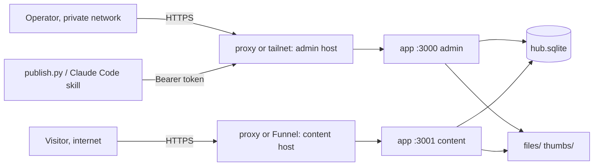

# Architecture

## Components



One Node 24 process runs two independent [Hono](https://hono.dev) apps:

- **admin** (`src/admin/`): the JSON API under `/api` and the built React SPA (`web/dist`). Strict CSP
  `default-src 'self'; img-src 'self' data:; style-src 'self'; frame-src <content origin>; frame-ancestors 'none'; base-uri 'none'; form-action 'self'`
  (`frame-src`: the live preview and quick look, design 14).
  Any other path serves `index.html`; the SPA routes with TanStack Router (`web/src/router.tsx`): `/` the gallery
  root, `/f/<name>` a folder, `/unfiled` artifacts with no folder, `?a=<id>` an artifact's panel over any of them.
- **content** (`src/content/`): artifact files, unlock forms, share-link exchange, folder pages and folder
  thumbnails. It imports no admin route. Separation relies on ports and networks, never on the `Host` header.

Folders nest up to `MAX_FOLDER_DEPTH = 4` levels. `src/folder-tree.ts` holds the pure helpers (ancestors, children,
re-parent checks, children order). Effective folder access (`effectiveFolderAccess`, `src/content/folder-grant.ts`)
returns the granting folder, the folder or the highest ancestor whose own access is valid; folder pages, folder
artifact redirects, thumbnails and the breadcrumb all use it. Deleting a folder sheet re-parents its direct children
to its parent.

Server stack: TypeScript executed directly by Node (type stripping, no server build step), `node:sqlite`
(no native dependency; still marked experimental, hence the pinned Node version in the image), `node:crypto`
(scrypt, HKDF, HMAC, AES-GCM), `busboy`, `yauzl`, `markdown-it`, `highlight.js`, `sanitize-html`,
`beautiful-mermaid` (Mermaid to SVG, no DOM).
Admin UI: React 19, Vite, Tailwind 4, no runtime UI library, hand-drawn SVG icons, a tiny typed i18n layer.

## Request flow for a visitor

1. `GET /a/<slug>`: visibility check (public, or a valid grant cookie). Private or missing: 404. `code`: unlock form.
2. Redirect to a signed path `/a/<slug>/~<versionId>.<epoch>.<exp>.<mac>/<entry>`; relative assets inherit it.
3. Signed paths are served with the sandbox CSP and `Access-Control-Allow-Origin: *` (opaque origins send
   `Origin: null`); expired or stale signatures redirect to the unsigned path, which re-checks access.

Share links: `GET /share/<token>` exchanges the token for a grant cookie and redirects, so the token leaves the
address bar. Folder pages: `/d/<folder>`, cards enter through `/d/<folder>/a/<slug>`, which re-checks folder
access and current membership before issuing the usual signed path.

Fonts: visitor pages use Figtree, served by the content server itself (`/_fonts/<file>.woff2`, an allow-list, CORS
open for sandboxed pages); the admin SPA bundles the same files. No third-party request.

Artifact bar (design 10): a browser navigation (`Sec-Fetch-Dest: document`) to an entry gets a script-free frame
page instead of the redirect: a top bar (folder path, title, version, Original, Open alone) and the artifact in an
`<iframe>` on its signed path, which allows framing by the content origin only. HTML pages and sites get a
screen-size switch (`?w=tablet|mobile`, design 11); through a folder, previous / next links in visitor order.

Link previews (design 06): on those entry URLs, a known link-preview service (Slack, Teams, iMessage…) gets an Open
Graph page (title, excerpt, signed thumbnail URL `/og/<artifact>/<version>?s=…`, 24 h) instead of the redirect; people,
scripts and search engines never do.

## Data

```
data/
  hub.sqlite                                     # WAL, secure_delete
  files/<artifactId>/<versionId>/                # extracted content, immutable
  thumbs/<artifactId>/<versionId>.webp|png|jpg   # outside files/: never served by the content server directly
  tmp/  backup/
```

Main tables: `artifacts` (slug, title, description, kind, visibility, code hash, access epoch, current version, folder, pin,
folder position, `deleted_at` for the trash; every read goes through the `live_artifacts` view, which leaves trashed
rows out), `versions` (number, kind, entry path, size, thumbnail), `artifact_tags`, `projects` (folder sheets:
title, description, visibility, code hash, epoch, salt, `parent_name` (FK, ON UPDATE CASCADE), `position`),
`share_links` (artifact **or** folder target, token hash +
encrypted token, expiry, revocation, open count), `visit_days` / `folder_visit_days` (daily aggregates),
`visit_seen` (fingerprints, two days max), `admin_sessions`, `search_index` (FTS5: title, slug, tags, description and text of the
current version, one row per artifact, kept up to date by the API, `src/search.ts`). Migrations run in place at startup, idempotent, in one
transaction (`src/db.ts`).

Updates are atomic: a new version is extracted to its own folder, then one transaction inserts it and switches
`current_version_id`. Retention after each upload or restore: Markdown and HTML versions are kept forever; ZIP sites,
PDFs and JSON keep the 10 most recent; the current and the highest-numbered versions are never pruned.

Markdown and JSON reader pages are rendered once at upload time into `index.html` next to the stored source, in the
`HUB_LOCALE` language (`auto` renders English). `src/scripts/rerender-documents.ts` re-renders them after a template
or locale change. ` ```mermaid ` blocks become inline SVG at the same time (flowchart, state, sequence, class, ER and
XY charts); other diagram types and syntax errors stay code blocks.

## Admin API

All routes are under `/api`, JSON in and out, authenticated by session cookie (mutations need `Origin` and
`X-CSRF-Token`) or by `Authorization: Bearer <token>`. Errors are `{ "code": "<stable_code>", "error": "<English
message>", "params"?: {…} }`; codes are listed in `app/src/errors.ts`.

| Method | Route | Purpose |
|---|---|---|
| GET | `/session` | Session state and CSRF token |
| POST | `/login`, `/logout` | Session (not available with the API token) |
| GET | `/artifacts` | List; `?slug=` exact match, `?project=`, `?tag=` (repeatable) |
| POST | `/artifacts` | Create (multipart: `file`, `title`, `description`, `slug`, `visibility`, `code`, `memoryStorage`, `project`, `tags`) |
| GET, PATCH, DELETE | `/artifacts/:id` | Detail with links; update title, description, slug, visibility, code, memoryStorage, project, tags, pinned; delete (to the trash, or for good with `TRASH_DAYS=0`) |
| POST | `/artifacts/bulk` | One operation on 1 to 500 artifacts in one transaction, all or nothing (`ids`, `op`: `move`, `addTags`, `removeTags`, `visibility` without `code`, `pin`, `unpin`, `trash`, `restore`; `value`) |
| POST | `/artifacts/:id/restore` | Bring a trashed artifact back (without a folder if its folder was deleted meanwhile) |
| GET, DELETE | `/trash` | Trashed artifacts with their purge date; empty the trash |
| DELETE | `/trash/:id` | Delete one trashed artifact for good |
| PUT | `/artifacts/:id/content` | New version (multipart `file`) |
| POST | `/artifacts/:id/revoke-all` | Bump the access epoch |
| POST | `/artifacts/:id/share` | Switch to link visibility and create a link in one call (`hours`, `label`) |
| POST, DELETE | `/artifacts/:id/links[/:linkId]` | Create (`label`, `expiresAt`) or revoke a share link |
| GET | `/artifacts/:id/preview` | Signed admin preview URL (1 h) |
| GET | `/artifacts/:id/stats?days=N` | Views, uniques, daily series, link opens |
| GET | `/artifacts/:id/versions` | Versions, newest first |
| GET | `/artifacts/:id/versions/:versionId/preview` | Pinned preview URL of any kept version |
| POST | `/artifacts/:id/versions/:versionId/restore` | Make a version current |
| GET | `/artifacts/:id/thumbnail`, `/artifacts/:id/versions/:versionId/thumbnail` | Thumbnails (private cache, ETag) |
| PUT | `/artifacts/:id/versions/:versionId/thumbnail` | Raw WebP/PNG/JPEG body, 2 MiB max |
| GET | `/tags` | Tag counts |
| GET, POST | `/projects` | Folders with counts, activity and recent artifacts; create an empty private folder |
| GET, PATCH, DELETE | `/projects/:name` | Folder detail; update title, description, visibility, code, name (rename); delete the sheet |
| GET | `/projects/:name/preview` | Signed visitor-page preview URL (1 h) |
| POST | `/projects/:name/share`, `/projects/:name/revoke-all` | Share for N hours; bump the folder epoch |
| PUT | `/projects/:name/order` | Card order (`ids`) |
| POST, DELETE | `/projects/:name/links[/:linkId]` | Folder share links |
| GET | `/projects/:name/stats?days=N` | Folder page visits |
| GET | `/search?q=` | Full-text search of live artifacts (title, slug, tags, text of the current version): ids, best first, with a highlighted snippet of a text match |
| GET | `/slugs/:slug` | Slug validity and availability (`inTrash` when a trashed artifact holds it) |

## Internationalisation

- Admin SPA: `web/src/i18n/{en,fr}.ts` dictionaries with typed keys, `t(key, params)`, `tn(key, n)` for plurals
  (`Intl.PluralRules`), dates and numbers through `Intl` in the active locale. The locale is the saved preference
  (`localStorage`), else `navigator.language` (`fr*` → French), else English; the toolbar and sign-in screen have a switch.
- Visitor pages: `src/i18n.ts`, chosen per request from `HUB_LOCALE` (`auto` reads `Accept-Language`); `<html lang>`
  follows, French typography (non-breaking spaces) only on French pages.
- API errors: stable codes, English messages; the SPA maps codes to localised text and falls back to the message.
